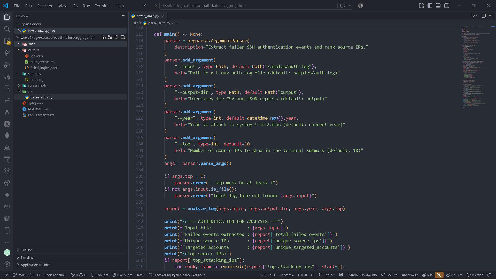
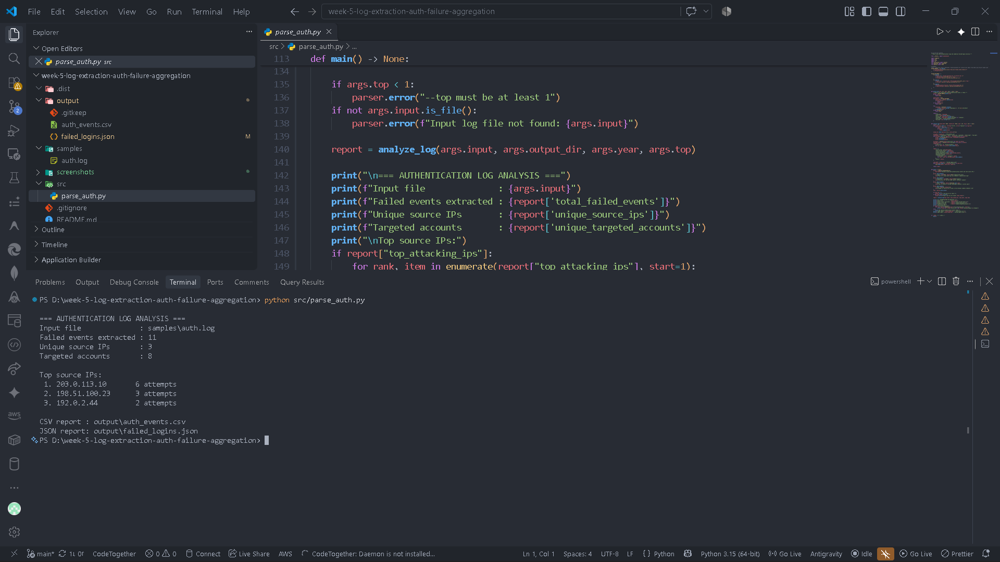
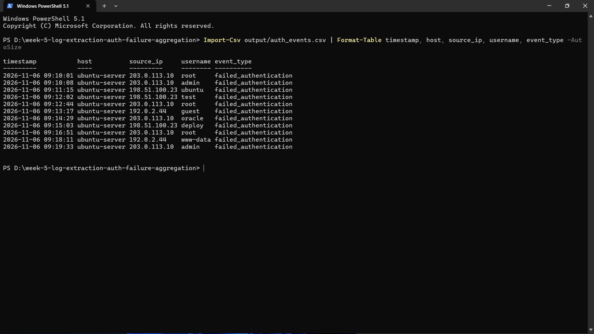
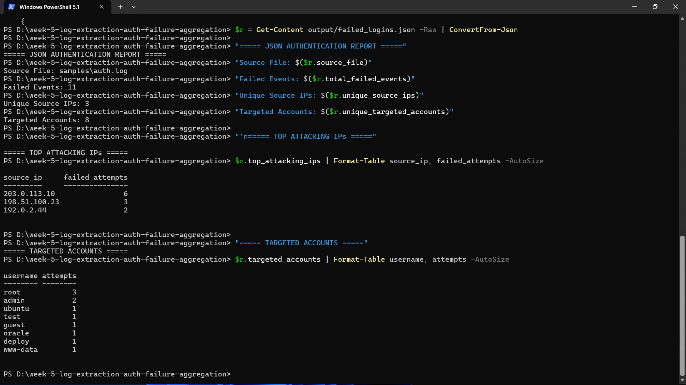
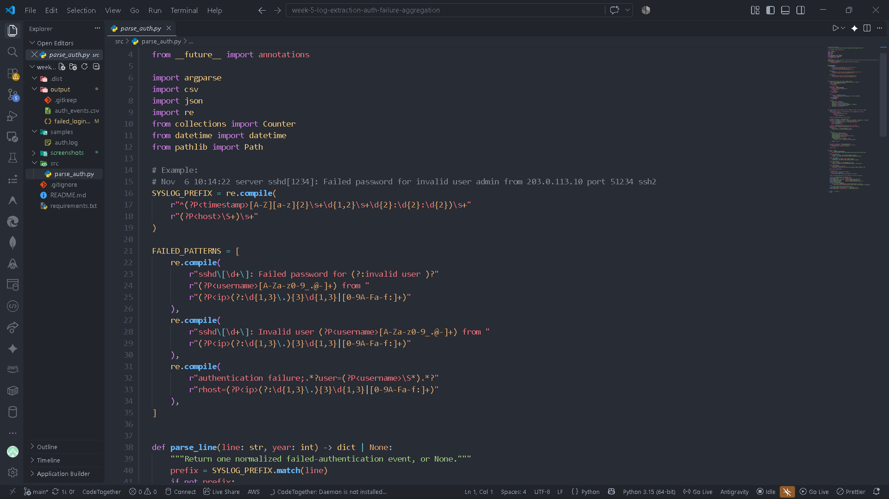
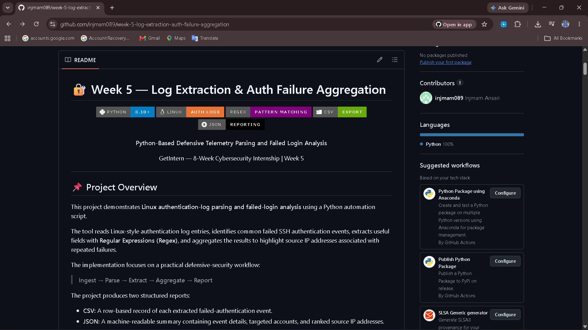

# 🔐 Week 5 — Log Extraction & Auth Failure Aggregation

<p align="center">


</p>

<p align="center">
  <strong>Python-Based Defensive Telemetry Parsing and Failed Login Analysis</strong>
</p>

<p align="center">
  GetIntern — 8-Week Cybersecurity Internship | Week 5
</p>

---

## 📌 Project Overview

This project demonstrates **Linux authentication-log parsing and failed-login analysis** using a Python automation script.

The tool reads Linux-style authentication log entries, identifies common failed SSH authentication events, extracts useful fields with **Regular Expressions (Regex)**, and aggregates the results to highlight source IP addresses associated with repeated failures.

The implementation focuses on a practical defensive-security workflow:

> **Ingest → Parse → Extract → Aggregate → Report**

The project produces two structured reports:

- **CSV:** A row-based record of each extracted failed-authentication event.
- **JSON:** A machine-readable summary containing event details, targeted accounts, and ranked source IP addresses.

A synthetic sample log is included so the project can be executed and demonstrated on Windows without requiring a Linux server. The parser can also be pointed at an authorized Linux `auth.log` file.

---

## 🎯 Objectives

The main objectives of this task were:

1. Understand the purpose and structure of Linux authentication logs.
2. Read and process raw log files using Python.
3. Apply Regular Expressions to identify failed authentication events.
4. Extract timestamps, hostnames, source IP addresses, and targeted usernames.
5. Aggregate failed attempts by source IP address.
6. Rank source IP addresses by the number of observed failures.
7. Export normalized telemetry to CSV and JSON formats.
8. Verify the generated output and document the workflow.

---

## 🧠 What is Defensive Telemetry?

**Defensive telemetry** is the collection and analysis of system or network activity data that helps defenders understand what is happening in an environment.

Authentication logs are one useful telemetry source. They can record events such as:

- Failed password attempts
- Attempts involving invalid usernames
- Successful authentication
- Source addresses associated with login activity
- Timestamps and host information

Repeated authentication failures from one source may indicate password guessing or another suspicious pattern. However, repeated failures alone do **not** prove that an attack occurred. The events should be reviewed alongside other security context.

---

## 🏗️ Environment

| Component | Details |
|---|---|
| Operating System | Windows 11 for development and testing |
| Language | Python 3 |
| Log Format | Linux syslog-style authentication entries |
| Parsing Method | Regular Expressions (`re`) |
| Data Processing | Python standard library |
| Output Formats | CSV and JSON |
| Editor | Visual Studio Code |
| Version Control | Git |
| Repository Hosting | GitHub |
| Training | GetIntern Cybersecurity Internship |
| Task | Week 5 — Log Extraction & Auth Failure Aggregation |

---

## 🛠️ Tools & Python Modules Used

- **Python** — Main implementation language.
- **Regular Expressions (`re`)** — Pattern matching and field extraction.
- **`csv`** — Writing extracted events to a CSV file.
- **`json`** — Creating a structured JSON report.
- **`collections.Counter`** — Counting failures by IP address and username.
- **`argparse`** — Accepting input and output paths through command-line arguments.
- **`pathlib`** — Handling file and directory paths.
- **Visual Studio Code** — Development and execution.
- **Git & GitHub** — Version control and project documentation.

The project uses only Python standard-library modules. **No third-party packages are required.**

---

## 📁 Project Structure

```text
week-5-log-extraction-auth-failure-aggregation/
│
├── src/
│   └── parse_auth.py
│
├── samples/
│   └── auth.log
│
├── output/
│   ├── auth_events.csv
│   └── failed_logins.json
│
├── screenshots/
│   ├── 01-project-structure.png
│   ├── 02-terminal-execution.png
│   ├── 03-csv-output.png
│   ├── 04-json-report.png
│   ├── 05-python-parser.png
│   └── 06-readme-preview.png
│
├── .gitignore
├── README.md
└── requirements.txt
```

### File Description

| File / Folder | Purpose |
|---|---|
| `src/parse_auth.py` | Main Python log-parsing and aggregation script |
| `samples/auth.log` | Synthetic Linux-style authentication log for testing |
| `output/auth_events.csv` | Extracted failed-authentication events |
| `output/failed_logins.json` | Structured event and aggregation report |
| `screenshots/` | Practical execution and output evidence |
| `requirements.txt` | Dependency note; no external packages are needed |
| `README.md` | Project documentation |

The `screenshots/` directory is prepared for evidence images. Add the actual screenshots before publishing the repository; do not leave placeholder image files.

---

## 🏛️ Log Analysis Workflow

The parser follows this sequence:

```text
                 Authentication Log
                         │
                         ▼
                  Read Input File
                         │
                         ▼
                 Check Log Structure
                         │
                         ▼
              Match Failed-Login Patterns
                         │
                         ▼
             Extract Timestamp, Host, IP,
                  and Username
                         │
                         ▼
                Normalize Event Data
                         │
                         ▼
             Aggregate by Source IP/User
                         │
                         ▼
                Rank Frequent Sources
                         │
              ┌──────────┴──────────┐
              ▼                     ▼
          CSV Export            JSON Report
              │                     │
              └──────────┬──────────┘
                         ▼
                  Review Findings
```

---

## 1️⃣ Telemetry Ingestion

The script reads a text-based authentication log file line by line.

The included demonstration file is:

```text
samples/auth.log
```

A Linux system commonly stores authentication-related events in:

```text
/var/log/auth.log
```

The exact log location and format can vary by Linux distribution and logging configuration. On some systems, authentication messages may be available through the system journal instead.

### Example Log Entry

```text
Nov  6 09:10:01 ubuntu-server sshd[1001]: Failed password for root from 203.0.113.10 port 51001 ssh2
```

This entry contains information that can be useful during authentication-event analysis:

- Timestamp: `Nov 6 09:10:01`
- Host: `ubuntu-server`
- Username: `root`
- Source IP: `203.0.113.10`
- Event: Failed SSH password authentication

The parser preserves the original log line in the output for traceability.

---

## 2️⃣ Pattern Extraction Using Regular Expressions

The Python `re` module is used to search for known authentication-log patterns.

### Syslog Prefix Pattern

The script uses a prefix pattern to capture the timestamp and hostname:

```python
SYSLOG_PREFIX = re.compile(
    r"^(?P<timestamp>[A-Z][a-z]{2}\s+\d{1,2}\s+\d{2}:\d{2}:\d{2})\s+"
    r"(?P<host>\S+)\s+"
)
```

### Failed Password Pattern

A representative pattern extracts the targeted username and source IP:

```python
re.compile(
    r"sshd\[\d+\]: Failed password for (?:invalid user )?"
    r"(?P<username>[A-Za-z0-9_.@-]+) from "
    r"(?P<ip>(?:\d{1,3}\.){3}\d{1,3}|[0-9A-Fa-f:]+)"
)
```

### Important Regex Elements

| Regex Element | Purpose |
|---|---|
| `^` | Matches the beginning of a line |
| `\s+` | Matches one or more whitespace characters |
| `\S+` | Matches a non-whitespace sequence |
| `\d+` | Matches one or more digits |
| `(?:...)` | Groups alternatives without capturing the group |
| `(?P<username>...)` | Captures a named username field |
| `(?P<ip>...)` | Captures a named source IP field |

The parser also recognizes common `Invalid user ... from ...` and `authentication failure` message formats.

> **Scope note:** These patterns cover selected common Linux/OpenSSH log formats. They are not a universal parser for every distribution, SSH implementation, or authentication service.

---

## 3️⃣ Failed Authentication Event Extraction

For each matching event, the script creates a normalized record containing:

| Field | Description |
|---|---|
| `timestamp` | Parsed date and time |
| `host` | Hostname that generated the log |
| `source_ip` | Remote IP address recorded in the event |
| `username` | Account name associated with the attempt |
| `event_type` | Normalized event category |
| `raw_log` | Original log entry |

Successful-login messages are not included in the failed-authentication event dataset.

The script uses the year supplied through the command line because traditional syslog timestamps commonly omit the year. If no year is supplied, the current system year is used.

---

## 4️⃣ Anomaly Aggregation & Source Ranking

After extracting the failed-authentication events, the script uses Python's `Counter` to count activity.

### Source IP Aggregation

```python
ip_counts = Counter(
    event["source_ip"] for event in events
)
```

This produces a frequency count for each source IP address.

### Username Aggregation

```python
username_counts = Counter(
    event["username"] for event in events
)
```

This helps identify which account names appear most frequently in the extracted events.

### Ranking

The script uses:

```python
ip_counts.most_common(top_n)
```

to display the most frequent source IP addresses.

This ranking is a **triage aid**, not a definitive attacker identification mechanism. Shared networks, NAT, proxies, testing activity, and misconfigured clients can also produce repeated failures.

---

## 5️⃣ CSV & JSON Report Generation

The tool generates two output files inside the `output/` directory.

### 📄 CSV Report — `auth_events.csv`

The CSV file contains one row for each extracted failed-authentication event.

Example structure:

```csv
timestamp,host,source_ip,username,event_type,raw_log
2026-11-06 09:10:01,ubuntu-server,203.0.113.10,root,failed_authentication,...
```

CSV is useful for:

- Reviewing events in spreadsheet applications.
- Filtering and sorting authentication records.
- Importing telemetry into other analysis tools.

### 📦 JSON Report — `failed_logins.json`

The JSON report contains:

- Total failed events
- Number of unique source IP addresses
- Number of unique targeted accounts
- Ranked source IP addresses
- Targeted account frequency
- Extracted event records

JSON is useful for structured reporting and integration with other Python tools or monitoring pipelines.

---

## ▶️ How to Run

### Requirements

- Python 3.10 or newer
- Visual Studio Code or another terminal
- A log file you are authorized to analyze

No external Python packages are required.

### Step 1 — Clone the Repository

```bash
git clone <YOUR-GITHUB-REPOSITORY-URL>
```

Replace the placeholder with the public repository URL after the repository is created.

### Step 2 — Enter the Project Directory

```bash
cd week-5-log-extraction-auth-failure-aggregation
```

### Step 3 — Check Python Version

```bash
python --version
```

### Step 4 — Execute the Parser

```bash
python src/parse_auth.py
```

The default command reads `samples/auth.log` and writes reports to `output/`.

### Step 5 — Use Custom Arguments

```bash
python src/parse_auth.py --input samples/auth.log --output-dir output --year 2026 --top 10
```

| Argument | Purpose |
|---|---|
| `--input` | Path to the authentication log file |
| `--output-dir` | Directory for generated reports |
| `--year` | Year to attach to syslog timestamps |
| `--top` | Number of source IPs to display |

### Linux Example

On a Linux machine with permission to read the authentication log:

```bash
python3 src/parse_auth.py --input /var/log/auth.log --output-dir output --year 2026
```

Access to `/var/log/auth.log` may require elevated permissions. Use only logs you own or are authorized to inspect.

---

## 🧪 Execution & Verification

Run the parser:

```bash
python src/parse_auth.py
```

The terminal displays:

- Input file path
- Number of failed events extracted
- Number of unique source IPs
- Number of targeted accounts
- Ranked source IP addresses
- CSV and JSON output paths

### Verified Sample Dataset Results

The included synthetic sample contains **11 failed-authentication events** and one successful-login entry, which is ignored by the parser.

| Metric | Result |
|---|---:|
| Failed events extracted | 11 |
| Unique source IPs | 3 |
| Unique targeted accounts | 8 |

### Top Source IPs in the Sample

| Rank | Source IP | Failed Attempts |
|---:|---|---:|
| 1 | `203.0.113.10` | 6 |
| 2 | `198.51.100.23` | 3 |
| 3 | `192.0.2.44` | 2 |

These are documentation-only IP address ranges used for examples. They do not identify real attacking systems.

### Verify Generated Files

In PowerShell:

```powershell
Get-ChildItem output
```

Open the CSV:

```powershell
code output/auth_events.csv
```

Open the JSON report:

```powershell
code output/failed_logins.json
```

The generated reports should be reviewed to confirm that the extracted fields and aggregate counts match the source sample.

---

# 📸 Evidence & Screenshots

The following screenshots demonstrate the project structure,
execution, extracted telemetry, generated reports, and implementation.

### 01 — Project Structure


### 02 — Terminal Execution


### 03 — CSV Output


### 04 — JSON Report


### 05 — Python Parser


### 06 — README Preview


---

## 🔍 Security Considerations & Limitations

This project is an educational defensive-telemetry parser. It is designed to demonstrate basic log processing and aggregation, not to replace a SIEM or a production intrusion-detection platform.

Important considerations:

- Log formats can differ across Linux distributions and authentication services.
- Traditional syslog timestamps may omit the year.
- The parser recognizes selected patterns; unrecognized events may be skipped.
- The current IPv4 pattern checks the address shape but does not validate every octet's numeric range.
- A source IP with many failures is not automatically malicious.
- NAT, proxies, shared networks, and authorized security tests can affect counts.
- The script does not block IP addresses or change firewall rules.
- Sensitive production logs may contain personal or operational information and should be handled securely.

---

## 🧠 Security Concepts Learned

Through this practical task, the following concepts were applied:

### 1. Authentication Log Analysis

Understanding how Linux authentication events can support defensive investigation.

### 2. Regular Expression Matching

Using patterns and named capture groups to extract useful fields from unstructured text.

### 3. Telemetry Normalization

Converting raw log lines into consistent event records.

### 4. Frequency-Based Anomaly Triage

Aggregating repeated failures to identify activity that may need further investigation.

### 5. Structured Data Reporting

Exporting analysis results to CSV and JSON for review and reuse.

### 6. Defensive Security Mindset

Using evidence from logs to guide investigation rather than assuming that one indicator proves malicious activity.

---

## 🚧 Current Scope

The current version focuses on:

- Linux/OpenSSH failed-authentication log parsing
- Selected authentication failure patterns
- Timestamp, hostname, username, and source IP extraction
- Failed-attempt aggregation
- Top source IP ranking
- CSV and JSON reporting
- Command-line input and output options

It does not currently implement:

- Live log streaming
- Real-time alerting
- IP reputation lookups
- GeoIP enrichment
- Automatic IP blocking
- SIEM integration
- Dashboard visualization
- Machine-learning-based anomaly detection
- Multi-source correlation

---

## 🔮 Future Improvements

Possible future versions could introduce:

```text
v2.0
├── Additional Linux authentication patterns
├── IPv4 address validation
├── Improved IPv6 parsing
├── Configurable detection rules
├── Time-window-based aggregation
├── Threshold-based alerts
├── Log rotation support
├── Unit tests
├── Dashboard visualization
└── SIEM integration
```

These improvements would help evolve the project into a more flexible defensive log-analysis utility.

---

## 📚 Learning Outcomes

This project provided practical exposure to:

- Python scripting
- Linux authentication logs
- Regular Expressions
- Log parsing and normalization
- Failed-login analysis
- Frequency aggregation
- CSV and JSON data handling
- Command-line arguments
- Defensive telemetry
- Git and GitHub workflow
- Technical documentation

The key takeaway was that **raw logs become more useful when they are parsed, structured, correlated, and interpreted in context.**

---

## 🏁 Conclusion

The Week 5 practical demonstrates a Python-based workflow for extracting and analyzing failed authentication events from Linux-style log files.

The implementation:

- Reads authentication log entries.
- Identifies selected failed SSH authentication patterns.
- Extracts timestamps, hostnames, source IPs, and usernames.
- Aggregates failures by source IP and targeted account.
- Ranks frequent source IP addresses.
- Generates CSV and JSON reports.
- Provides reproducible sample data and execution instructions.

This project builds on foundational Linux security work and provides a practical introduction to defensive telemetry, log analysis, and security-event triage.

---

## 👨‍💻 Author

**Injmam Ansari**

Cybersecurity Intern — GetIntern.in

Week 5 — Defensive Telemetry & Log Parsing.

---

## ⚖️ Disclaimer

This project was developed for **cybersecurity learning and educational purposes** as part of internship training.

The included authentication log is synthetic demonstration data. Analyze only systems and log files that you own or have explicit authorization to access. Do not use the output alone to accuse, identify, or take action against a source IP address.
